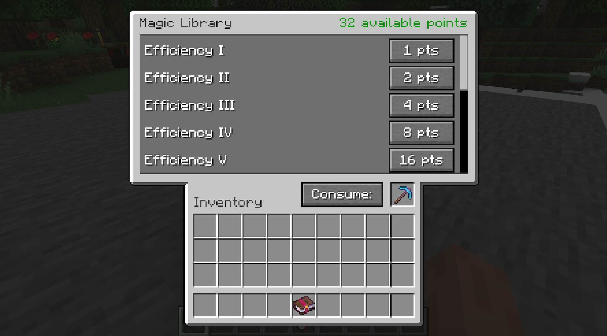

# Magic Library

This is a a mod that offers a 'magic library': a storage for your enchantment books.
You can put books in, and then retrieve (single) enchantment books out of it, depending on which books (and how many of them) you put in.

It uses a points system where each enchantment has a points value, which then can be be used interchangeably to retrieve other enchantment books, provided you put in those enchantments in the first place.

It also supports extracting enchantments from regular items/tools/equipment (anything with an enchantment), but you can only retrieve books out of the library.